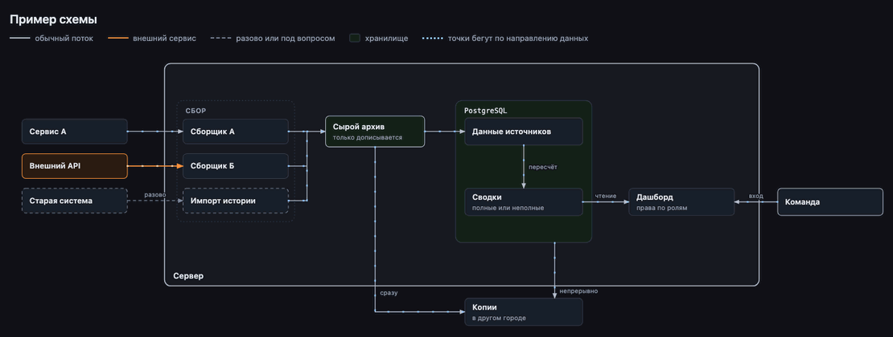
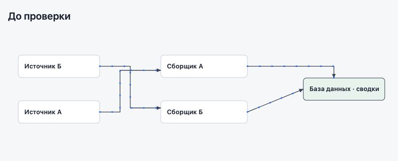
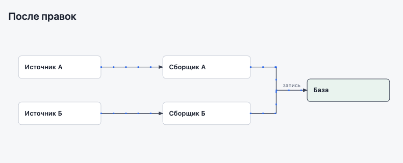
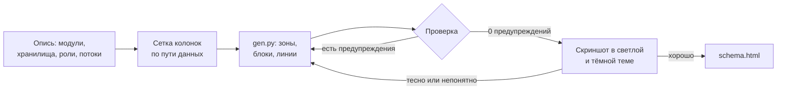

<div align="center">

# system-diagram

**Скилл для Claude Code: схемы систем, которые не стыдно показать**

Claude пишет схему кодом, сам проверяет её на пересечения и наложения,<br>
смотрит на скриншот и отдаёт готовую HTML-страницу со светлой и тёмной темой.



<sub>Точки бегут туда, куда идут данные. Анимация отключается, если в системе включено «уменьшить движение».</sub>

</div>

---

## Зачем

Схемы, нарисованные нейросетью «на глаз», обычно ломаются одинаково: линии пересекаются и идут друг по другу, текст вылезает за блоки, стрелки висят в воздухе, а после третьей правки всё съезжает.

Этот скилл меняет подход:

| Обычно | С этим скиллом |
|---|---|
| SVG пишется руками, координаты подбираются на глаз | Схему строит скрипт `gen.py`: сетка колонок, блоки, линии от краёв блоков |
| Ошибки видит человек, когда открыл картинку | Встроенная проверка находит их до того, как картинку кто-то увидит |
| Правка одного блока ломает соседние | Линии привязаны к блокам и едут вместе с ними |
| Простыни текста внутри блоков | Заголовок, одна строка, подписи стрелок в 1–3 слова |
| Одна тема, мелкий шрифт на телефоне | Светлая и тёмная тема, горизонтальная прокрутка на узком экране |

## Проверка в деле

Слева схема с типичными ошибками, справа она же после правок по предупреждениям.

<table>
<tr>
<th width="50%">До проверки</th>
<th width="50%">После правок</th>
</tr>
<tr>
<td>
<picture>
  <source media="(prefers-color-scheme: dark)" srcset="docs/bad-dark.png">
  
</picture>
</td>
<td>
<picture>
  <source media="(prefers-color-scheme: dark)" srcset="docs/good-dark.png">
  
</picture>
</td>
</tr>
</table>

Что напечатала проверка для левой схемы:

```text
ПРОВЕРКА: «·» в тексте: 'База данных · сводки' — замените запятой или словами
ПРОВЕРКА: текст не влезает в «База данных · сводки»: нужно ~172px, ширина 160
ПРОВЕРКА: косая линия (470, 152.0)→(580, 107.0) — ведите горизонтально и вертикально
ПРОВЕРКА: линии пересекаются: (240, 62.0)→(240, 144.0) и (220, 70.0)→(300, 70.0)
bad.html: блоков 5, предупреждений 4
```

<details>
<summary><b>Все проверки</b></summary>

| Проверка | Что ловит |
|---|---|
| Пересечения | две линии перекрещиваются |
| Линии друг по другу | разные потоки идут по одному отрезку, и не видно, где какой (общий ствол у развилки допускается) |
| Косые линии | отрезок не горизонтальный и не вертикальный |
| Сквозь блок | линия проходит через чужой блок |
| Конец в воздухе | стрелка не начинается и не заканчивается у блока, зоны или шины |
| Наложение | блоки или подписи стрелок залезают друг на друга |
| Длина текста | заголовок или подпись не влезает в ширину блока |
| За краем | блок выходит за холст |
| «·» | символ, которым люди не пользуются; вместо него запятые и слова |

</details>

## Как это работает



Первый шаг важнее, чем кажется. Скилл сначала составляет полный список модулей и только потом рисует. Поэтому, когда схему просят «сделать проще», он сокращает подписи, а не выкидывает копии, мониторинг и другие «скучные» блоки.

## Установка

```bash
git clone https://github.com/geniuses43/system-diagram ~/.claude/skills/system-diagram
```

Скилл подхватится в новой сессии Claude Code. Нужны Python 3 и, для скриншотов, Google Chrome или Chromium. Сторонних библиотек нет.

## Как попросить

Достаточно описать систему обычными словами:

> Нарисуй схему нашего сервиса: данные приходят из трёх API и из Google-таблицы, складываются в сырой архив, проверяются и попадают в Postgres. Из базы их читает Grafana, копии уходят в S3.

> Обнови схему: добавь препрод и покажи, как изменения попадают в прод.

> На схеме тесно справа и непонятно, что делает блок «Журнал». Поправь.

## Свой генератор за 5 минут

```python
from diagram import Diagram

d = Diagram(900, 300, aria='Сборщик кладёт данные в базу, дашборд их читает')
d.zone(200, 20, 500, 200, 'Сервер', kind='server', label_at='bottom')

api  = d.box(20,  80, 150, 44, 'Внешний API', kind='ext')
job  = d.box(230, 80, 150, 44, 'Сборщик')
db   = d.box(430, 80, 150, 44, 'База', 'только дописывается', kind='data')
dash = d.box(730, 80, 150, 44, 'Дашборд', 'права по ролям')

d.line([api.right(), job.left()], kind='acc')
d.line([job.right(), db.left()], label='запись')
d.line([db.right(), dash.left()], label='чтение')

d.save('schema.html', title='Мой сервис',
       legend=[('acc', 'внешний сервис'), ('data', 'хранилище')])
```

Полный пример с зонами, шиной, планами и копиями: [`scripts/example_gen.py`](scripts/example_gen.py).

<details>
<summary><b>Справочник API</b></summary>

| Вызов | Что рисует |
|---|---|
| `Diagram(W, H, aria)` | холст; `aria` — описание схемы для экранного диктора |
| `d.zone(x, y, w, h, label, kind)` | область: `server` — сплошная рамка, `group` — пунктир, `data` — заливка хранилища |
| `d.box(x, y, w, h, title, sub, kind)` | блок: `box`, `ext` (акцент), `data`, `plan` (пунктир), `role`, `key` |
| `b.left()` `b.right()` `b.top()` `b.bottom()` | точки на сторонах блока, со сдвигом: `b.right(10)` |
| `d.line(points, kind, label, at, both)` | стрелка: `fg`, `acc`, `plan`; `both=True` — в обе стороны |
| `d.bus(points)` | общая шина без стрелки, в неё сходятся несколько потоков |
| `d.edge_label(x, y, text)` | отдельная подпись у линии |
| `d.save(path, title, legend, caption)` | HTML-страница и печать предупреждений проверки |

</details>

## Что внутри

```text
system-diagram/
├── SKILL.md            порядок работы и правила для Claude
├── scripts/
│   ├── diagram.py      библиотека: блоки, линии, зоны, проверки
│   ├── example_gen.py  пример генератора, с него удобно начинать
│   └── shot.sh         скриншот страницы через headless Chrome
└── assets/
    └── head.html       оформление: цвета-токены, светлая и тёмная тема
```

## Правила, на которых держится скилл

- **Роли, а не имена:** «ответственный за метрики», «команда», «ИИ-агент».
- **Схема не ТЗ:** у блока заголовок и одна короткая строка, объяснения идут в документ.
- **Краткость — это короткие подписи, а не меньше блоков.**
- **Цвет только для смысла:** один акцент на одну важную категорию.
- **Легенда только для того, что повторяется.** Остальное подписано прямо на схеме.

## Лицензия

[MIT](LICENSE)
